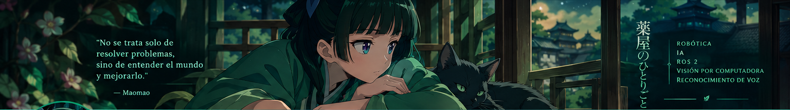

<!--
Perfil de GitHub para 1230235-cloud.
Banner: assets/banner-maomao-verde.png
-->

  

<h1 align="center">🌿 ¡Hola! Soy Lister</h1>

  <strong>Ingeniería en Sistemas Computacionales · Robótica · Inteligencia Artificial</strong> 
  Construyendo sistemas inteligentes que conectan el software con el mundo real.

  
  
  

---

## 🧪 Sobre mí

Soy estudiante de Ingeniería en Sistemas Computacionales en la Universidad de Montemorelos. Me interesa diseñar, integrar y probar soluciones que combinan software, electrónica e inteligencia artificial, especialmente en robótica móvil, reconocimiento de voz e interacción humano-robot.

- 🤖 Desarrollo y experimentación con robots y sistemas autónomos.
- 🎙️ Reconocimiento de voz e interacción humano-robot con ROS 2.
- 👁️ Visión por computadora y procesamiento de video con OpenCV y FFmpeg.
- 🧩 Programación, bases de datos y aplicaciones web.
- 🌱 Siempre aprendiendo y convirtiendo ideas en proyectos funcionales.

## 🏆 Experiencia destacada

**Primer lugar nacional — categoría @Home Beginners, con el equipo Eva@Home.**

Participé en tareas de **reconocimiento de voz** y **pruebas de interacción humano-robot**, contribuyendo al desarrollo y evaluación del sistema para la competencia.

## 🛠️ Tecnologías y herramientas

  
  
  
  
  
  
  
  
  
  

## 🚀 Proyectos que me interesan

### 🤖 Robótica móvil

Robots seguidores de línea y sumo, lectura de sensores, control de motores y experimentación con estrategias de navegación.

### 🎙️ Reconocimiento de voz con ROS 2

Exploración de comandos de voz, Vosk y flujos de interacción para robots, teniendo en cuenta los recursos de hardware y la capacidad de respuesta del sistema.

### 👁️ Visión por computadora y video

Procesamiento de imágenes y video con OpenCV y FFmpeg, incluyendo filtros visuales y transformaciones en tiempo real.

### 📊 Aplicaciones y análisis de datos

Desarrollo de aplicaciones web, consultas a bases de datos y herramientas de análisis utilizando tecnologías como React, Node.js y SQL Server.

  

---

## 📊 Mi actividad en GitHub

  

## 🔥 Racha de contribuciones

  

  <em>🌿 Cada contribución es un paso más hacia un sistema inteligente.</em>

---

## 🎯 En qué quiero seguir creciendo

- 🤖 Profundizar en ROS 2, robótica autónoma e interacción humano-robot.
- 🧠 Mejorar mis habilidades en inteligencia artificial y visión por computadora.
- 🔬 Construir proyectos documentados, reproducibles y útiles.
- 🏆 Participar en más competencias y colaborar en proyectos de ingeniería.
- 🌱 Aprender nuevas tecnologías y convertir ideas en soluciones funcionales.

---

  <em>「La curiosidad también es una forma de inteligencia.」 — Maomao</em>
    
  Gracias por visitar mi perfil · Sigue aprendiendo, sigue construyendo 🌿
    
  

